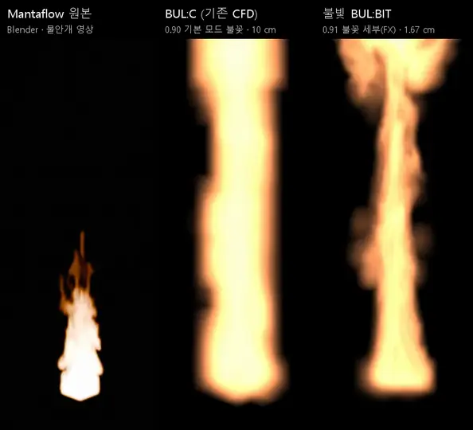

# BUL:BIT (불빛) — 화재 렌더러

> BUL:C computes the fire. BUL:BIT renders it. — 불씨(BUL:C)가 불을 계산하고, 불빛(BUL:BIT)이 그 불을 그린다.

**BUL:BIT(불빛)는 화재 렌더러입니다.** 메테오시뮬레이션의 화재 시뮬레이터 BUL:C(불씨) GPU 코어로 계산한 불꽃과 연기를 영상,
게임 엔진, 로봇 시뮬레이터(NVIDIA Isaac Sim)의 카메라 화면으로 그립니다.

이 저장소에는 **빌드된 프로그램만** 있습니다(소스 코드는 공개하지 않습니다). 프로그램은 [Releases](https://github.com/using76/bulc-render-open/releases)에서 받습니다.

- **[사용설명서](docs/MANUAL.md)**: 설치, 로그인, 계산, 렌더, Isaac Sim, 문제 해결
- **[이용 조건](LICENSE.md)**: 15일 무료 이용권, 연구·교육용, 상업적 사용 불가

---

## 샘플

### BUL:BIT 기본 모드 렌더


자동차운반선 갑판의 전기차 화재(열방출률 1.876·t², 10 MW까지)를 `bulbit_sim`으로 계산하고, 그 기본 모드 프레임을
BUL:BIT 렌더러로 그렸습니다. 불꽃은 열방출률(`hrrpuv`)로, 연기는 그을음(`smoke_sigma`)으로 그립니다. 카메라 두 대, 20·40·70·100 s.
차와 갑판 같은 형상은 그리지 않았습니다(형상은 쓰는 엔진이 그립니다). 차 모양으로 비어 보이는 곳은 연기가 들어가지 않는
차 안쪽입니다.

### 홍보 영상에서

| ISO 9705 방 구석 화재 | 사족보행 로봇이 불타는 차 옆을 걸어가 포탑을 겨눔 |
|---|---|
|  |  |
| [MP4 (10 s, 1280×720)](docs/samples/watermist_iso9705_corner_fire.mp4) | [MP4 (10 s, 1280×720)](docs/samples/robot_quadruped_walk_turret_aim.mp4) |
| 미분무 소화 홍보 영상의 도입부입니다. **BUL:C 계산이 아니라 Blender로 그린 개요 장면입니다**(불꽃은 BULC기반 형상작성후 Blender Mantaflow, 렌더는 EEVEE, 연기는 BULC기반). | 불과 연기는 **BUL:C 계산**입니다(자동차운반선 갑판 EV 화재, 28~32 s, 약 1.5~1.9 MW). 렌더는 지금의 BUL:BIT 렌더러보다 먼저 쓰던 Blender Cycles 파이프라인입니다. **로봇과 그 움직임은 일러스트**(스크립트 애니메이션)이고, 학습한 정책이나 Isaac Sim 물리가 아닙니다 |

### 불빛 BUL:BIT 불꽃 세부(FX), 0.91.0부터



[MP4 (6 s, 792×720)](docs/samples/bulbit_fx_flame_detail.mp4)

**불꽃 세부(FX)는 BUL:BIT 0.91.0부터 들어 있습니다.**
- 기본 모드의 불꽃은 열방출률을 0.1 m 격자로 옮긴 것이라 매끈한 덩어리로 보입니다.
- FX는 불 둘레의 작은 상자에서 불꽃을 약 1.7 cm 격자로 GPU에서 따로 풀어, Mantaflow 불꽃처럼 깜빡이고 작게 흔들리는 불꽃을 만듭니다.
- 불이 어디서 얼마나 크게 타는지는 BUL:C 계산의 열방출률(`hrrpuv`)을 따릅니다.

**사용 방법은 다음과 같습니다.**

```bat
:: FX 불꽃으로 20~25 s 영상 (30 fps PNG, ffmpeg이 있으면 video.mp4도)
python C:\BULBIT\examples\render_fx_video.py iso9705_200kw_nvdb 20 25 fx_20_25

:: 비교용: 0.90 방식의 기본 불꽃
python C:\BULBIT\examples\render_fx_video.py iso9705_200kw_nvdb 20 25 basic_20_25 --flame basic

:: 벽에 붙은 불: 상자를 벽에 맞추고 그 면을 닫습니다 (방 구석 버너의 예)
python C:\BULBIT\examples\render_fx_video.py corner_nvdb 40 46 fx_corner --box -0.1 -0.1 0 0.9 0.9 2.4 --walls x- y- z- z+
```

```python
from bulbit.fx import FlameFX

fx = FlameFX(renderer, "iso9705_200kw_nvdb", t0=20.0, t1=25.0)   # 상자와 격자는 불꽃을 보고 정합니다
fx.start()                                                       # t0 - 3 s부터 예열
while fx.t < fx.t1 - 1e-9:
    fx.step()                    # 1/30 s 진행. 렌더러의 불꽃이 FX 불꽃으로 바뀝니다
    renderer.render([cam], W, H, depth=depth, download=False)
```

옵션, 바꿀 수 있는 값, 속도, 한계는 [사용설명서 6.5절](docs/MANUAL.md#65-불꽃-세부-fx-0910부터)에 있습니다.

**위 영상:** 미분무 영상의 ISO 9705 방 구석 화재(약 200 kW)를 같은 카메라로, 불꽃만 그렸습니다.
- **Mantaflow 원본**: 홍보 영상에 쓴 Blender Mantaflow 불꽃(Blender 렌더)
- **BUL:C (기존 CFD)**: 0.90 기본 모드 불꽃. BUL:C 열방출률을 0.1 m 격자로 옮긴 것(BUL:BIT 렌더러)
- **불빛 BUL:BIT**: 0.91 불꽃 세부(FX)(BUL:BIT 렌더러). 벽 두 면과 바닥·천장을 닫은 상자로 풀었습니다

| | Mantaflow 원본 | BUL:C (기존 CFD) | 불빛 BUL:BIT |
|---|---|---|---|
| 불꽃 면적 (픽셀) | 17,918 | 90,611 | 88,689 |
| 밝기 깜빡임 | 0.155 | 0.066 | 0.192 |
| 면적 변동 | 0.139 | 0.054 | 0.130 |

- 불꽃 크기는 BUL:C와 같고, 깜빡임과 면적 변동은 Mantaflow에 가깝습니다. Mantaflow 불꽃은 영상용으로 짧게 맞춘 크기입니다.
- BUL:BIT 쪽 두 화면은 0.91.0 개발 빌드로 그렸습니다. 배포판에서는 크기 기준과 불꽃 원천 처리를 조금 다듬었습니다.
- 기본 모드 프레임에는 속도가 없어서, 바람이나 문 쪽 흐름에 기운 불꽃도 FX에서는 곧게 섭니다(설명서 6.5절 "한계").

---

## 들어 있는 것

| 구성 | 파일 | 하는 일 |
|---|---|---|
| 계산 코어 | `bin/bulbit_sim.exe` | FDS 형식 화재 입력(`.fds`)을 GPU로 계산하고, 렌더용 NanoVDB 프레임만 씁니다 |
| 렌더 라이브러리 | `bin/bulbit.dll`, `include/bulbit.h` | 연기와 불꽃 볼륨을 카메라 영상으로 그립니다(CUDA, C ABI) |
| Python | `python/bulbit`, `python/bulbit_basic` | 렌더러 바인딩(torch·Warp·CuPy CUDA 배열을 복사 없이), 프레임 읽기, 열방출률로 불꽃 만들기, 불꽃 세부 `bulbit.fx`(0.91.0부터) |
| 예제 | `examples/` | ISO 9705 방 200 kW 화재 입력, 프레임 한 장을 PNG로 그리는 스크립트, 불꽃 세부 영상 스크립트 |

**기본 모드만 열려 있습니다.** 프레임마다 `smoke_sigma`(그을음 소광계수, 1/m), `hrrpuv`(열방출률, kW/m³),
`visibility`(시야, m)를 내보내고, 불꽃과 연기를 그립니다. Pro 기능(온도, 속도, CO, CO₂, 압력, 열화상 등)은 잠겨 있습니다.

BUL:BIT는 영상과 로봇·AI 학습용입니다. 공학 출력(측정점, CSV, 슬라이스)은 내지 않습니다. 공학 해석에는 BUL:C를 쓰십시오.

## 필요한 것

- Windows 10/11 64비트
- NVIDIA GPU, 연산 능력 8.6 이상(GeForce RTX 30·40·50 계열 등)과 CUDA 13.1 이상을 지원하는 드라이버
- BUL:C 계정(https://bulc.msimul.com). 로그인할 때 인터넷이 필요합니다
- 렌더에는 Python 3.10+와 numpy, scipy, torch(CUDA). Isaac Sim·Isaac Lab의 Python에 모두 들어 있습니다

## 빠른 시작

```bat
:: 1. Releases의 bulbit-0.91.0-win64.zip을 C:\BULBIT 에 풉니다

:: 2. 로그인: 이용 조건이 나오고, 브라우저에서 BUL:C 계정으로 로그인합니다
C:\BULBIT\bin\bulbit_sim.exe login

:: 3. 계산: iso9705_200kw_nvdb\ 에 0.1 s마다 프레임이 생깁니다
copy C:\BULBIT\examples\iso9705_200kw.fds .
C:\BULBIT\bin\bulbit_sim.exe iso9705_200kw.fds > run.log 2>&1

:: 4. 렌더: 20 s 프레임의 불꽃과 연기를 PNG로
set BULBIT_HOME=C:\BULBIT
python C:\BULBIT\examples\render_basic_frame.py iso9705_200kw_nvdb 20.0 fire_20s.png

:: 5. 불꽃 세부(FX) 영상 (0.91.0부터): 20~25 s, 30 fps
python C:\BULBIT\examples\render_fx_video.py iso9705_200kw_nvdb 20 25 fx_20_25
```

자세한 내용은 [사용설명서](docs/MANUAL.md)에 있습니다.

## 이용 조건

- BUL:C 계정으로 로그인한 PC에서 **처음 로그인한 때부터 15일** 동안 쓸 수 있습니다.
- 무료체험 버전은 **연구와 교육 목적으로만** 쓸 수 있습니다. **상업적 용도로는 쓸 수 없습니다.**
- 15일이 지난 뒤에도 쓰려면 문의 바랍니다: **simul@msimul.com**, **https://bulc.msimul.com**
- 상업용 이용은 문의 바랍니다.
- 전체 조건: [LICENSE.md](LICENSE.md). 함께 배포하는 NVIDIA cuFFT: [THIRD_PARTY_NOTICES.md](THIRD_PARTY_NOTICES.md).

---

## English

**BUL:BIT is a fire renderer.** It draws the flames and smoke computed by the GPU core of BUL:C, Meteor Simulation's fire
simulator, into video, game engines and robot simulators (NVIDIA Isaac Sim). This repository holds the built program only;
download it from [Releases](https://github.com/using76/bulc-render-open/releases).

- `bulbit_sim.exe` computes a fire from an FDS-format input and writes NanoVDB frames for rendering (no engineering outputs).
- `bulbit.dll` (C ABI) and the `bulbit` Python package render the smoke and flame volumes; `bulbit_basic` reads the frames
  and makes the flame field from the heat release rate.
- **Basic mode only:** each frame carries `smoke_sigma` (soot extinction, 1/m), `hrrpuv` (heat release rate, kW/m³) and
  `visibility` (m); fire and smoke are rendered. Pro features (temperature, velocity, CO, CO₂, pressure, thermal) are locked.
- **License:** sign in with a BUL:C account (`bulbit_sim login`); usable for **15 days** from the first sign-in on a computer,
  **research and education only, no commercial use**. To continue, contact simul@msimul.com or https://bulc.msimul.com.
- Requirements: Windows 10/11 x64, an NVIDIA GPU with compute capability 8.6 or higher and a driver for CUDA 13.1 or later.
- The promo-film clips above are honest about what they are: the ISO 9705 clip is a Blender illustration (not BUL:C); in
  the robot clip the fire and smoke are BUL:C results rendered with an earlier Blender pipeline, and the robot is an
  illustration.
- **New in 0.91.0: flame detail (FX).** A small GPU flame solver on a fine box (about 1.7 cm) around the fire adds the
  flicker and small eddies of a Mantaflow-style flame; where and how big the fire burns follows the BUL:C heat release
  rate. Usage: `python examples/render_fx_video.py <CHID>_nvdb t0 t1 out_dir`, or `bulbit.fx.FlameFX` in Python
  ([MP4](docs/samples/bulbit_fx_flame_detail.mp4): Mantaflow, BUL:C (existing CFD) and BUL:BIT with FX on the ISO 9705
  corner fire; manual section 6.5). The calculation core `bulbit_sim` is the same as in 0.90.0.

© 2026 메테오시뮬레이션 (Meteor Simulation). All rights reserved.
